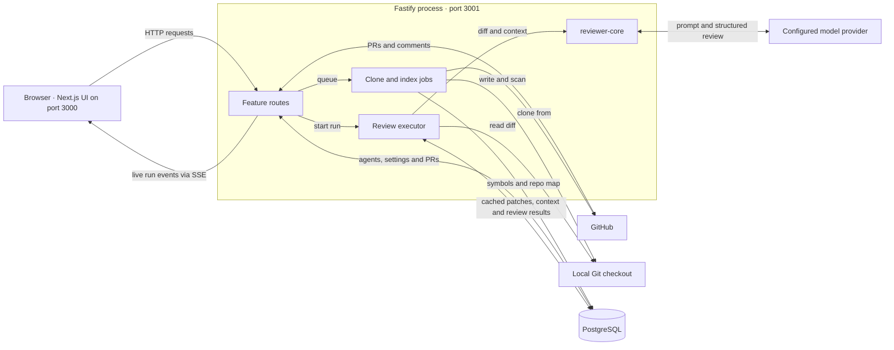

# DevDigest developer onboarding

DevDigest is a local-first GitHub PR review studio. You add a repository, open a pull request, and choose an agent to review it. The app stores the findings and run history locally. A real review sends the diff, the PR description when available, and selected repository context to the agent's configured model provider.

## First run on Windows

Use **Node 22, pnpm 10, Git, and Docker Desktop** to match the repo's CI setup. Run Compose from the repository root so it uses the loopback-only Postgres binding.

From the root in PowerShell, prepare the database and start the API:

```powershell
docker compose up -d --wait
if (!(Test-Path server/.env)) { Copy-Item server/.env.example server/.env }
if (!(Test-Path client/.env)) { Copy-Item client/.env.example client/.env }
Push-Location reviewer-core
npm.cmd ci
Pop-Location
Set-Location server
pnpm.cmd install
pnpm.cmd db:migrate
pnpm.cmd db:seed
pnpm.cmd dev
```

From the root in a second terminal, run `cd client`, `pnpm.cmd install`, then `pnpm.cmd dev`. Open `http://localhost:3000`. The API listens on `http://localhost:3001`. Check `/health/ready` for database connectivity and `/workspace` for the seeded identity. If you use Bash, [scripts/dev.sh](../scripts/dev.sh) runs the same bootstrap.

- **Try it without keys.** Open seeded repo `acme/payments-api` and PR `#482` to see the diff and a saved review. Keep the seed step on a fresh database. It creates the user and workspace used by the no-login request path along with demo data. [Seed script](../server/src/db/seed.ts) · [Local auth](../server/src/adapters/auth/local.ts)
- **Review a real PR.** In **Settings → API Keys**, add your GitHub token and the key for your agent's provider. The three seeded reviewers use OpenRouter. You can select another provider and model under **Agents**. Add a GitHub repo, open a PR, choose **Run Review**, then inspect **Findings** and the run trace. Inline comments and replies in **Files changed** go to GitHub. [Agent presets](../server/src/db/seed.ts#L180) · [Settings routes](../server/src/modules/settings/routes.ts) · [PR routes](../server/src/modules/pulls/routes.ts#L254)

## Architecture overview

During local development, Next.js and Fastify run as separate Node.js processes on the host. Docker runs PostgreSQL 16 with pgvector. The review engine and indexing jobs execute inside the API process. [Development launcher](../scripts/dev.sh) · [Database container](../docker-compose.yml)



The API returns a run ID before the model finishes. The browser uses that ID to subscribe to live events. After a reload it can retrieve the saved run and trace from Postgres. If indexing is incomplete, a review can proceed with the available diff. [Review service](../server/src/modules/reviews/service.ts) · [Client run hooks](../client/src/lib/hooks/reviews.ts)

## Technical stack and key packages

Each package has its own manifest and lockfile. Use pnpm in `client/` and `server/`, and npm in `reviewer-core/` and `e2e/`. The API resolves reviewer-core through a TypeScript source alias, so both packages need their dependencies installed. [API aliases](../server/tsconfig.json) · [Bootstrap script](../scripts/dev.sh)

| Layer | Packages and their role |
| --- | --- |
| Web studio | Next.js 15 provides routing, React 19 renders the UI, and `@tanstack/react-query` caches and refreshes API data. `next-intl` supplies UI messages. Tailwind CSS 4 and the vendored UI kit supply styling and reusable controls. [Client manifest](../client/package.json) |
| API and contracts | Fastify 5 hosts the feature routes. Zod 3 and `fastify-type-provider-zod` validate route inputs. `fastify-sse-v2` streams live review events. [API setup](../server/src/app.ts) |
| Database and jobs | `drizzle-orm` maps TypeScript schemas to PostgreSQL, `postgres` is the database driver, and `drizzle-kit` generates migrations. `p-queue` schedules clone and index jobs in memory while the API records their status in Postgres. [Server manifest](../server/package.json) · [Job runner](../server/src/platform/jobs.ts) |
| GitHub and repository indexing | `octokit` accesses GitHub PRs and comments. `simple-git` operates on local clones. `@ast-grep/napi` extracts symbols, `dependency-cruiser` builds the import graph, and `graphology` with `graphology-metrics` ranks files using PageRank. `js-tiktoken` measures the repo map against its token budget. [Indexing pipeline](../server/src/modules/repo-intel/README.md) · [File ranking](../server/src/modules/repo-intel/pipeline/rank.ts) |
| Model integration | The API selects a provider for each agent and injects it into reviewer-core. The adapters use `openai` for OpenAI and OpenRouter and `@anthropic-ai/sdk` for Anthropic. Reviewer-core uses Zod to define the expected review structure. [Provider wiring](../server/src/platform/container.ts) · [Engine manifest](../reviewer-core/package.json) |
| Development and tests | TypeScript checks types and `tsx` runs TypeScript entry points. Vitest runs unit tests, React Testing Library and jsdom exercise components, Testcontainers starts PostgreSQL for integration tests, and the `agent-browser` CLI drives end-to-end flows. [Test suite map](../TESTING.md) · [Browser harness](../e2e/README.md) |

### Package ownership

| Part | What it owns |
| --- | --- |
| [`client/`](../client/README.md) | Next.js App Router, React, TanStack Query and a vendored UI kit. Start with the page, its colocated components, then [query hooks](../client/src/lib/hooks/index.ts) and the [HTTP client](../client/src/lib/api.ts). The PR page routes by GitHub PR number. API calls use the internal PR UUID. |
| [`server/`](../server/README.md) | Fastify registers the feature modules statically. The dependency-injection container supplies Drizzle/Postgres, Git, GitHub, model providers, jobs and the run event bus. The app uses a seeded local identity and defaults to a loopback binding. [App setup](../server/src/app.ts) · [Container](../server/src/platform/container.ts) · [Module registry](../server/src/modules/index.ts) |
| [`reviewer-core/`](../reviewer-core/README.md) | Takes a diff, agent configuration, optional context and an injected model client. Builds the prompt, validates structured output, checks cited paths and lines against the diff, and calculates the score from surviving findings. The API imports its TypeScript source directly. [Core entry point](../reviewer-core/src/index.ts) · [Review pipeline](../reviewer-core/src/review/run.ts) |
| [`e2e/`](../e2e/README.md) | Drives the seeded web/API/Postgres stack with deterministic browser flows and no LLM calls. Component and server unit tests use Vitest. DB integration tests use Testcontainers. [Test matrix](../TESTING.md) |
| Shared code and tooling | The client and server each vendor a copy of `@devdigest/shared`. Reviewer-core resolves the server copy through a TypeScript alias. Check both copies when you change API contracts. The root also holds Compose, bootstrap scripts, CI workflows and prompt references. [Client contracts](../client/src/vendor/shared/index.ts) · [Server contracts](../server/src/vendor/shared/index.ts) · [Prompt references](agent-prompts/README.md) |

### Follow a PR through the server

1. **Add a repo.** `repos` validates the GitHub URL, writes a row, and queues a clone. The clone queues `repo-intel`, which extracts symbols and references, builds an import graph, ranks files, and caches a compact repo map. Index state powers the **Indexed** badge. [Repos service](../server/src/modules/repos/service.ts) · [Indexing pipeline](../server/src/modules/repo-intel/README.md)
2. **Open a PR.** `pulls` syncs recent GitHub PRs on list reads and loads files, commits, body and linked issue on detail reads. List and detail reads can fall back to persisted data. `polling` exposes a separate manual PR-list sync. Review starts from an explicit user action. [Pulls routes](../server/src/modules/pulls/routes.ts) · [Manual poll](../server/src/modules/polling/routes.ts)
3. **Run a review.** `agents` supplies the prompt, provider, model and review strategy. `settings` handles provider keys and connection tests. `workspace` returns the local workspace and user. `reviews` creates a run row per selected agent, returns run IDs immediately, and executes in the background. **Run all** executes enabled agents sequentially in the same request's background task. [Agents](../server/src/modules/agents/routes.ts) · [Workspace](../server/src/modules/workspace/routes.ts) · [Review service](../server/src/modules/reviews/service.ts)
4. **Read the result.** The executor tries a local Git diff, then reconstructs it from cached PR patches if necessary. It adds available repo-intel context and calls reviewer-core. The API streams progress over server-sent events and persists findings and traces in Postgres. Accept and dismiss update local findings. [Diff loader](../server/src/modules/reviews/diff-loader.ts) · [Run executor](../server/src/modules/reviews/run-executor.ts) · [Run and finding routes](../server/src/modules/reviews/routes.ts)

The database schema includes future milestones such as memory, evals and CI. The module registry and actual Next.js pages are the fastest way to see which capabilities are reachable. For example, the UI's `/onboarding` page adds a repository, while the planned onboarding generator has schema and prompt scaffolding.

## Questions worth resolving

| Priority | Finding or question |
| --- | --- |
| High | **Can a review be recorded against a different commit from the patches it analyzed?** List sync updates the stored head SHA, while detail sync rewrites cached files and commits without updating that SHA or grouping the writes in a transaction. If Git diff fails, the review can consume patches from another snapshot and still mark the stored SHA reviewed. Tie the cached diff and result to the same immutable head. [List sync](../server/src/modules/pulls/routes.ts#L49) · [Detail sync](../server/src/modules/pulls/routes.ts#L176) · [Diff fallback](../server/src/modules/reviews/diff-loader.ts) · [Review write](../server/src/modules/reviews/run-executor.ts#L213) |
| High | **What is the supported API launch path?** An in-memory TypeScript emit produced `dist/server/src/server.js`, while `pnpm start` points to `dist/server.js`. The emitted review executor also retains the `@devdigest/reviewer-core` alias. The dev command and browser CI use `tsx`, which resolves the source aliases. [API scripts](../server/package.json) · [TypeScript aliases](../server/tsconfig.json) · [Browser CI](../.github/workflows/e2e-web.yml) |
| Medium | **Can the final model call finish after cancellation?** The engine checks cancellation before each model call. After the final call returns, the executor proceeds to persist the review and mark the PR reviewed. Clarify whether cancellation should also suppress those writes. [Cancellation route and service](../server/src/modules/reviews/service.ts#L72) · [Model loop](../reviewer-core/src/review/run.ts#L162) · [Review write](../server/src/modules/reviews/run-executor.ts#L213) |
| Medium | **How complete should PR import be?** The adapter fetches one page of 50 recent PRs and one page of up to 100 files and commits per PR. The review path attempts a local Git diff using the refs already present in the clone. Large PRs can therefore produce a partial review when cached patches are the only available diff. [GitHub adapter](../server/src/adapters/github/octokit.ts) · [Git adapter](../server/src/adapters/git/simple-git.ts#L184) · [Diff loader](../server/src/modules/reviews/diff-loader.ts) |
| Medium | **Which setup instructions should newcomers follow?** The root README's manual steps omit reviewer-core dependency installation and copying env files. The migration and seed CLIs require `DATABASE_URL`. The root Compose file binds Postgres to loopback, while `server/docker-compose.yml` publishes it on all interfaces. Is Windows a supported setup? This branch contains a Windows entry-point fix, while the server CI typecheck runs on Ubuntu and `TESTING.md` says it also runs on Windows. [Root README](../README.md#manual-steps-what-the-script-does) · [Root Compose](../docker-compose.yml) · [Server Compose](../server/docker-compose.yml) · [Server CI](../.github/workflows/server-unit.yml) |
| Low | **What belongs to the starter baseline?** The README lists two seeded reviewers and puts multi-agent review, traces and live logs on the roadmap. The seed creates three reviewers, and the UI already supports running all agents independently, tracing each run and streaming logs. Define what additional behavior the milestone should deliver. [Roadmap](../README.md#roadmap) · [Seeded agents](../server/src/db/seed.ts#L180) · [Review service](../server/src/modules/reviews/service.ts) |

## Where to make your first change

- **UI or API integration:** Start at the feature page, follow its hook to the matching Fastify route, and run the client tests and typecheck.
- **Review behavior:** Start in reviewer-core for prompt, scoring or citation rules. Start in the server executor for data loading, run state or persistence. Run engine and server unit tests, plus DB integration tests for persistence changes.
- **Repository context:** Start at the repo-intel facade. Use the pipeline files when changing how the index is built, and check the index state before debugging empty review context.

This review covered the checkout at commit `b2387e5` and its local working tree. TypeScript checks passed for the client, server and reviewer-core. Vitest could not start its esbuild subprocess in the sandbox, and Docker access was denied there. DB integration, browser flows and live GitHub or model calls remain unverified.
